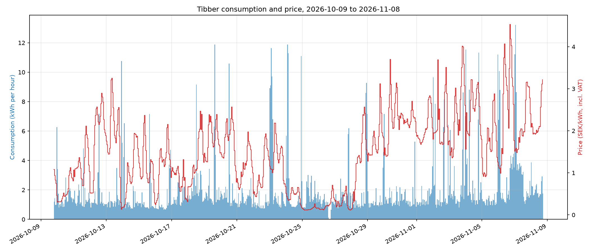

# Outsmarting the Power Grid: Python, Heat Pumps, and Day-Ahead Prices

Companion material for my talk at [PyCon Sweden 2026](https://pretalx.com/pycon-sweden-2026/speaker/MZBAMZ/), 19 November 2026.

The talk is about using Python on a Raspberry Pi to move electricity use away from the expensive hours: first a refrigerated game storage room, then the geothermal heat pump that heats our house. This repository holds the small scripts I used to fetch and plot prices and consumption for the slides.

- **Slides:** [slides.pdf](slides.pdf) <!-- TODO: add the PDF to the repo, or change the link -->

## The projects from the talk

| Project | What it does | Repository |
|---|---|---|
| Fridge controller | Price-aware thermostat for a refrigerated game storage room. It pre-cools during cheap hours and uses the thermal mass of the room to coast through the price peaks. | [github.com/digitalfotografen/fridge](https://github.com/digitalfotografen/fridge) |
| Heat pump controller | Pauses a geothermal heat pump (IVT Greenline, Rego637) during price peaks, and while the wood stove is burning. Runs as a service on a Raspberry Pi and logs to SQLite. | [github.com/digitalfotografen/heatpump](https://github.com/digitalfotografen/heatpump) |

## Code snippets in this repository

All scripts are short and meant to be read. Each one fetches some data and shows it with matplotlib.

| Script | What it shows | Needs |
|---|---|---|
| `nordpool_sample.py` | Today's day-ahead spot prices for price area SE3 at 15-minute resolution, straight from Nord Pool. About ten lines of code. | Nothing |
| `tibber_sample.py` | Today's Tibber prices at 15-minute resolution, including taxes and fees. The minimal version: the token is read from `TIBBER_TOKEN` only. | Tibber token |
| `plot_tibber_today.py` | The same plot as `tibber_sample.py`, but the token can also come from a `.env` file. | Tibber token |
| `plot_tibber_history.py` | Hourly consumption (bars) and price (line) in one chart, plus a summary that compares the price you actually paid per kWh with the plain average price. | Tibber token |
| `plot_tibber_live_current.py` | Live plot of current and voltage on each of the three phases, updated every second. | Tibber token and a Tibber Pulse |

Nord Pool gives the raw spot price in EUR/MWh. Tibber gives the price you pay as a customer in SEK/kWh, with taxes and fees included.



*Output from `plot_tibber_history.py`: one month of hourly consumption and price.*

## Running the scripts

You need [uv](https://docs.astral.sh/uv/) and Python 3.13 or newer.

```sh
git clone https://github.com/digitalfotografen/pycon2026.git
cd pycon2026
uv sync
```

The Nord Pool sample needs no account:

```sh
uv run src/pycon2026/nordpool_sample.py
```

The Tibber scripts declare their own dependencies at the top of the file ([inline script metadata](https://packaging.python.org/en/latest/specifications/inline-script-metadata/)), so `uv run` installs what they need:

```sh
uv run src/pycon2026/plot_tibber_today.py
uv run src/pycon2026/plot_tibber_history.py --days 7
uv run src/pycon2026/plot_tibber_history.py --save history.png
uv run src/pycon2026/plot_tibber_live_current.py --minutes 30
```

### Tibber token

The Tibber scripts need a personal API token, which you create at [developer.tibber.com](https://developer.tibber.com/). Give it to the scripts in one of two ways:

1. Set the environment variable `TIBBER_TOKEN`.
2. Create a file called `.env` in the repository root:

   ```ini
   [Tibber]
   api_key = <your token>
   ```

`.env` is listed in `.gitignore`. Keep it that way: the token gives access to your consumption data.

## Libraries

| Library | Used for |
|---|---|
| [nordpool](https://pypi.org/project/nordpool/) | Day-ahead spot prices from Nord Pool. Synchronous and very simple to use. |
| [pynordpool](https://pypi.org/project/pynordpool/) | Asynchronous Nord Pool client built on aiohttp. This is the library behind the Nord Pool integration in Home Assistant. |
| [pyTibber](https://pypi.org/project/pyTibber/) | Tibber API: prices, consumption history and live measurements from a Tibber Pulse. |

## About me

I am Ulrik Södergren, a freelance software developer and electronics engineer based in Gråbo, outside Gothenburg. Through my own consulting company [OddTech](https://oddtech.se) I solve odd problems that need a mix of software, electronics and image processing.

At the moment I work as a consultant for [Luxbright](https://www.luxbright.com/), a Gothenburg company that develops and manufactures microfocus X-ray tubes and X-ray sources for industrial, medical and analytical use. There I develop algorithms and software for enhancing X-ray images and validating image quality, as well as a Python framework for controlling lab and production equipment. I also design X-ray equipment and the electronics around it, from PCBs for X-ray tube testing to prototype X-ray systems, vacuum systems and sensor integration.

- LinkedIn: [linkedin.com/in/ulrik-sodergren](https://www.linkedin.com/in/ulrik-sodergren/)
- OddTech: [oddtech.se](https://oddtech.se)
